<p align="center"></p>

# ZivBot

**Agent-native dots on a FalkorDB graph.** Connect your apps *and your AI subscriptions* (Codex, Claude Code, Cursor, OpenCode, Grok, Antigravity). ZivBot maps all of it into one graph per user. Its personal agents, the **dots**, use that graph to decide what matters, talk to each other, and act through the right coding agent. Every answer comes with the Cypher path behind it.

> 🏁 **Graph Hacks: Context for AI Agents** (WeMakeDevs × FalkorDB)
> **Track:** Agents That Act on Connected Data (primary). It also covers Agent Memory and Coordination: per-user graphs, episodic/semantic/procedural memory, and dot-to-dot handoffs.
> **Demo video (2:47):** [watch](https://zivbot.vercel.app/demo.mp4) · [file](docs/zivbot-demo.mp4) · **Live:** [zivbot.vercel.app](https://zivbot.vercel.app) · **Built in:** Oct 15–18, 2026

<p align="center"><a href="https://zivbot.vercel.app/demo.mp4"><b>▶ Watch the 3-minute demo</b></a>: the real app, a real Codex run, Codex calling ZivBot over MCP. Voiceover by Chatterbox TTS.</p>

<p align="center">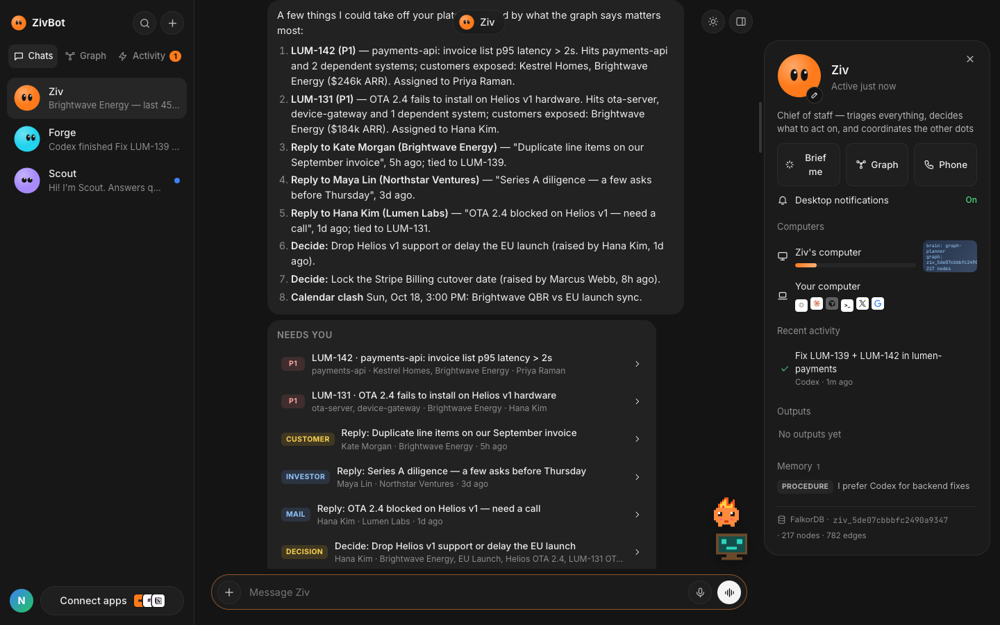</p>

| What's blocking the EU launch: BLOCKED_BY to the root blocker | What if Hana is out: the person removed from the graph |
|---|---|
| 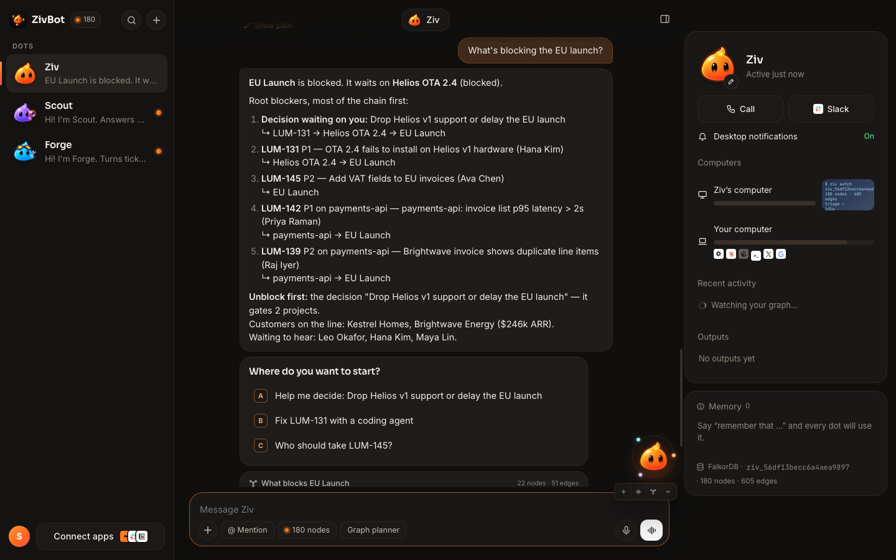 | 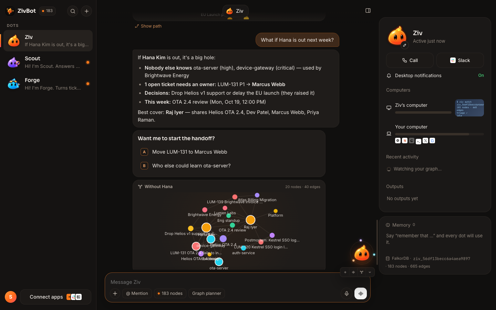 |
| **Customer health from tickets, incidents and threads** | **"The portal is slow": DEPENDS_ON upstream to the cause** |
| 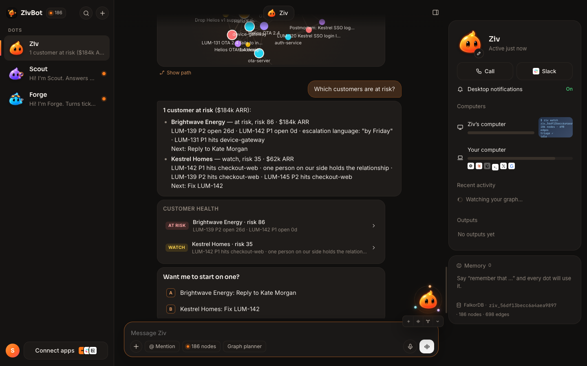 | 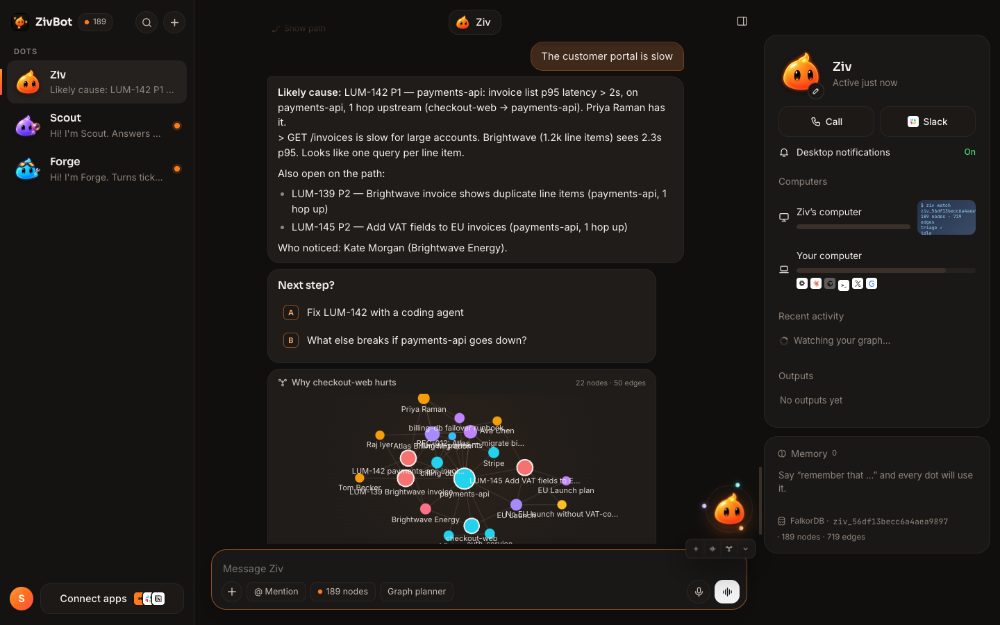 |
| **Options weighed on the graph before you decide** | **Counting and listing with aggregate Cypher** |
| 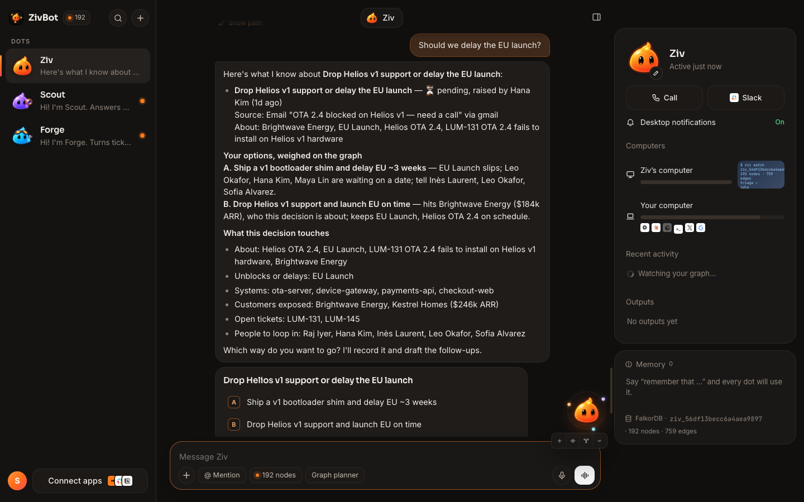 | 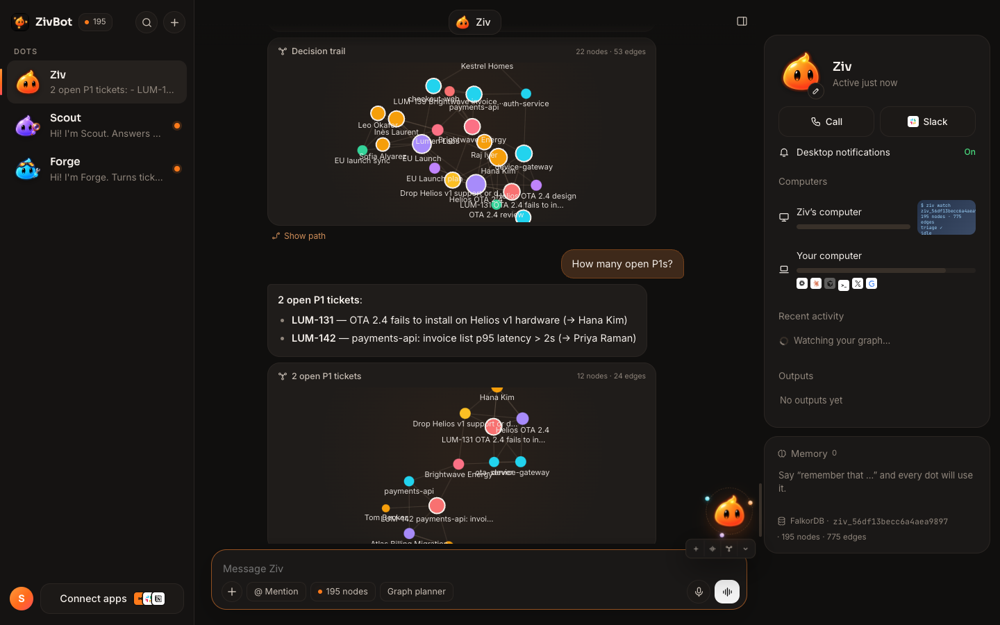 |
| **Show path: the Cypher behind every answer** | **A real Codex run, picked by graph routing** |
| 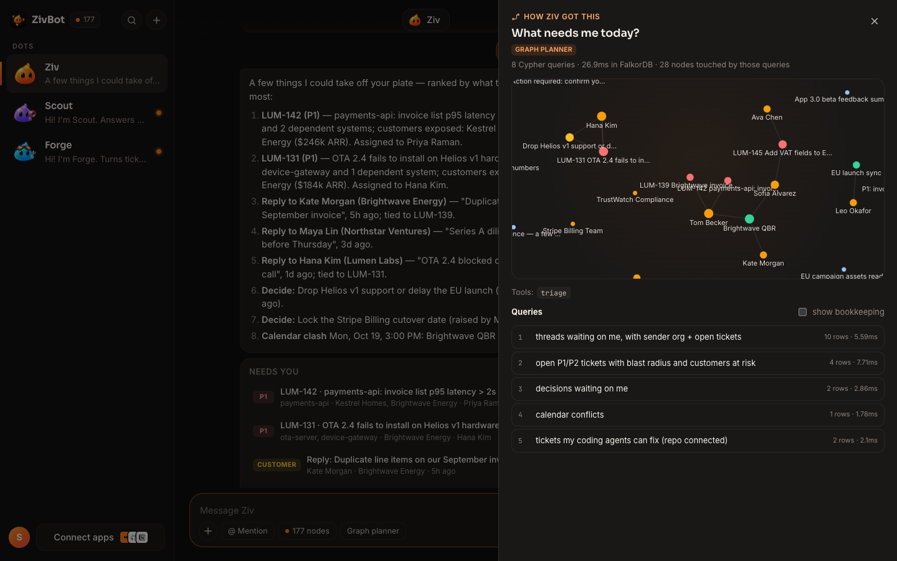 | 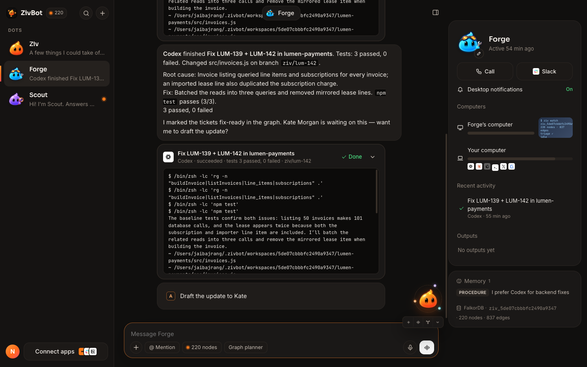 |
| **Insights: customers at risk, blocked work, bus factor, SPOFs** | **@-mention dots and plugins** |
| 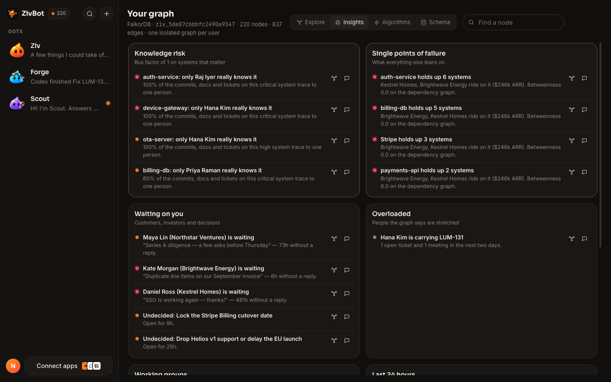 | 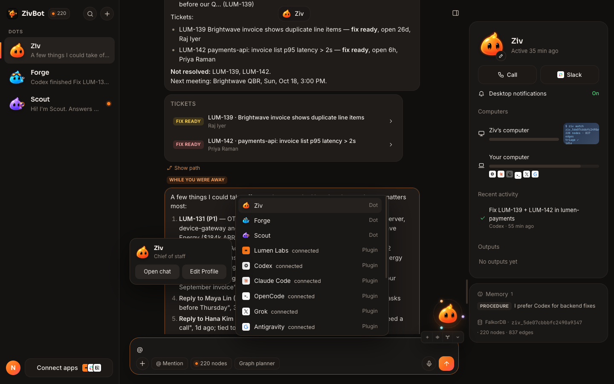 |
| **FalkorDB algorithms as tools** | **The live graph model (Schema)** |
| 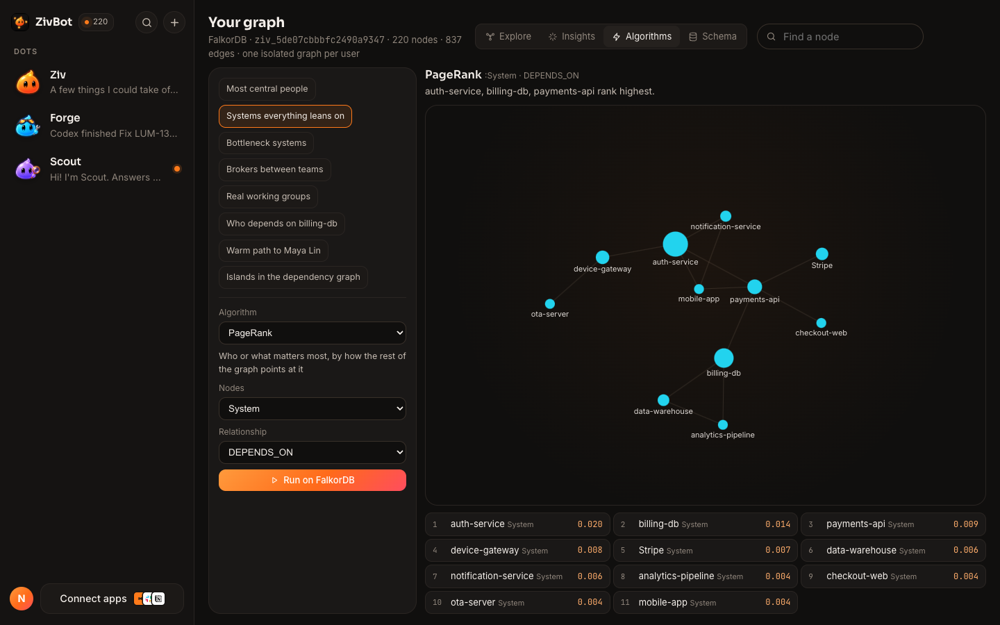 | 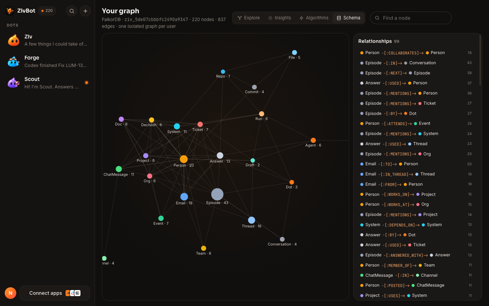 |
| **Your graph + Cypher console** | **Connect Apps, plus your graph over MCP** |
| 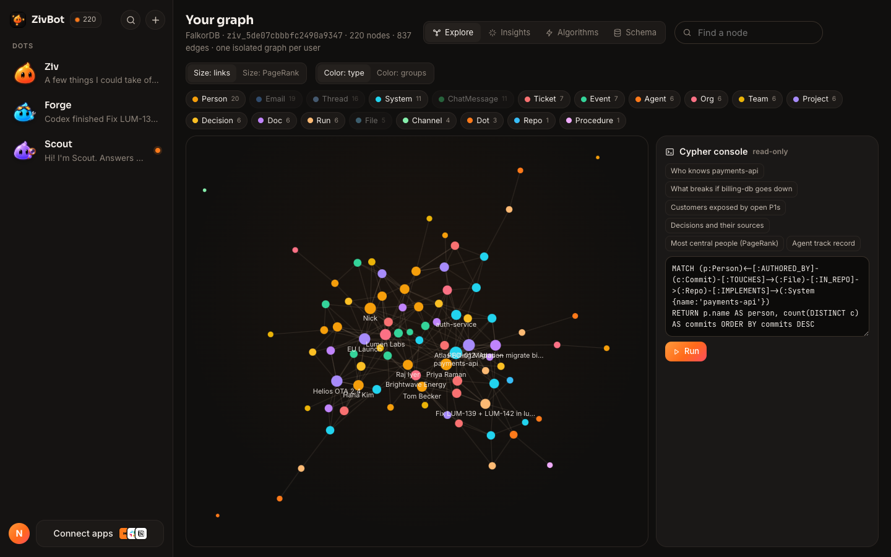 | 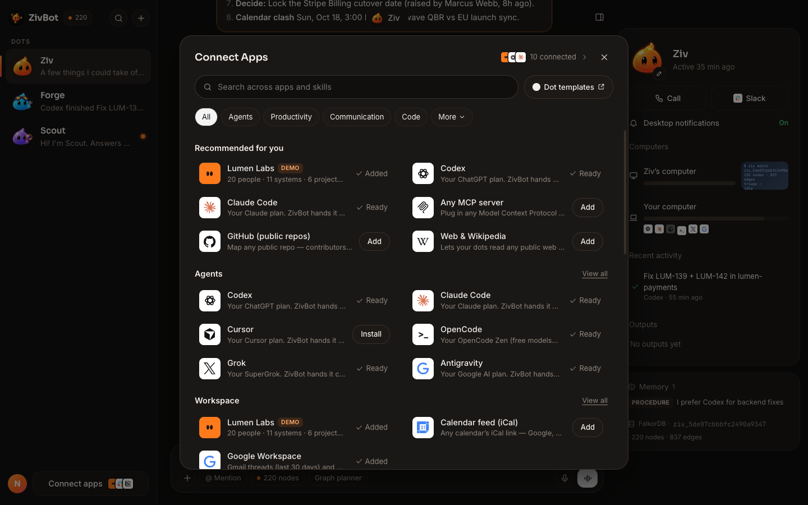 |
| **⌘K across dots and the whole graph** | **Phone width** |
| 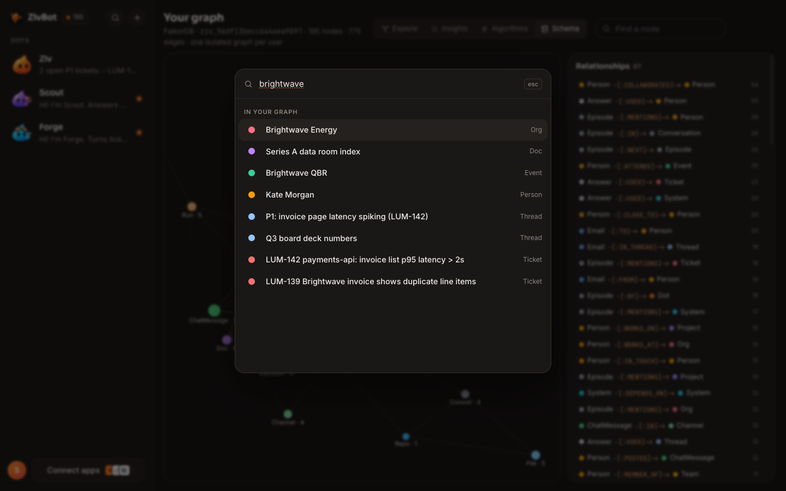 | 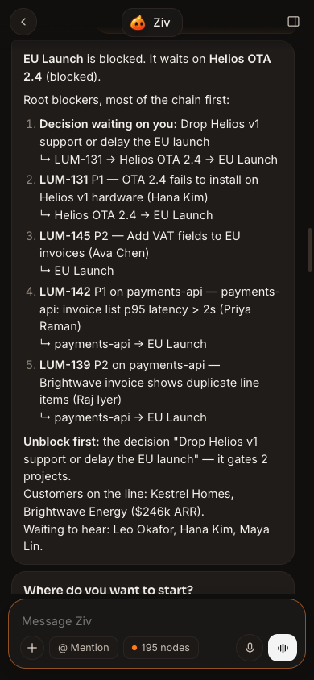 |

---

## Why a graph

The questions a chief of staff gets are never about one record:

| Question | Hops in the graph |
|---|---|
| *What should I handle first?* | Thread → sender → Org (ARR) · Ticket → System ← DEPENDS_ON\* ← System ← USES ← Customer |
| *Who knows payments-api?* | System ← IMPLEMENTS ← Repo ← IN_REPO ← File ← TOUCHES ← Commit → Person, plus Docs, Tickets, Projects, chat |
| *What breaks if billing-db goes down?* | `(:System)-[:DEPENDS_ON*1..4]->(billing-db)`, then customers, projects and open tickets on that radius |
| *Why did we move to Stripe?* | Decision → DECIDED_BY / APPROVED_BY → Person; Decision → SOURCE → Slack message + Notion RFC |
| *Which agent should fix this?* | Agent ← EXECUTED_BY ← Run → WORKED_ON → System (and its neighbours), quota state, Procedure → PREFERS → Agent |
| *Anything about the portal being slow?* | vector search over `:Memorable(emb)` → one hop to the tickets, people and customers each hit is about |
| *What's risky?* | `DEPENDS_ON*1..5` dependents + customer ARR, dependency PageRank (`algo.pageRank` over DEPENDS_ON), knowledge share per critical system |

The graph does real work in ZivBot (hackathon rule 3). Everything lives in FalkorDB and nowhere else:

- connected data
- chat history
- agent memory
- approvals
- runs
- tool registry
- provenance

Take FalkorDB away and nothing works.

## What it does

1. **Onboarding.** Ziv asks your name, you name it, and you connect a workspace.
2. **Connect everything.** Choose from 28 connectors in the *Connect Apps* catalog. They fall into four groups:
   - **No key:** public GitHub, local git repos, RSS, Hacker News, iCal feeds, local docs, Web/Wikipedia, any MCP server.
   - **Your AI subscriptions:** Codex, Claude Code, Cursor, OpenCode, Grok and Antigravity, detected on your computer.
   - **API key:** Gmail + Calendar, Slack, Notion, Linear, GitHub (private), Jira, Sentry, Stripe, HubSpot, Vercel, Firecrawl, Telegram, Discord. See [`TODO-KEYS.md`](TODO-KEYS.md).
   - **Demo:** the **Lumen Labs** synthetic workspace (mail, calendar, Slack, Notion, Linear and a real git repo).
3. **Triage from the graph.** Threads waiting on you are ranked by customer ARR and sender PageRank. P1/P2 tickets come with their blast radius and the ARR at risk. Pending decisions and calendar clashes are included too.
4. **Act through your agents.** "Fix LUM-142 and LUM-139":
   - Ziv hands the job to **Forge**, the engineering dot.
   - Forge pulls the diagnosis already in Slack and mail, plus the implementing repo and its authors, from the graph.
   - A graph query scores your installed agents.
   - You approve, and the agent runs headlessly on a branch. The tests run, and the result is written back as `(:Run)-[:RESOLVES]->(:Ticket)`.
   - If an agent hits its quota, the run is handed to the next-best agent.
5. **@-mention anything.** `@Forge fix LUM-142` hands the job to Forge. `@Hacker News FalkorDB` runs that plugin's tool. Mentions become `MENTIONS` edges in the graph.
6. **Semantic memory (GraphRAG).** Every message, mail, doc, ticket and decision gets a vector in **one FalkorDB vector index**. Fuzzy questions run a vector search, then follow the graph from each hit to what it's about.
7. **Insights.** One tab shows:
   - knowledge risk (bus factor on critical systems)
   - single points of failure (multi-hop `DEPENDS_ON` dependents, dependency PageRank, and the ARR riding on them)
   - who's waiting on you
   - who's overloaded
   - working groups (label propagation)
   - what changed in 24 hours (every node carries `firstSeen`/`lastSeen`)

   The background loop watches these too.
8. **Graph algorithms as agent tools.** `run_algorithm` gives every dot (and any MCP client) FalkorDB's `pageRank`, `betweenness`, `HarmonicCentrality`, `labelPropagation`, `WCC`, `BFS`, and weighted `SPpaths`, where collaboration strength becomes the edge cost for a "warm intro" path. Labels and relationships are allow-listed against the live schema. The **Algorithms** tab runs them visually (size = score, colour = group), and the **Schema** tab draws the live graph model with every index.
9. **Rebalance work.** "Who should take LUM-139?" ranks people by what they've done on the affected systems (commits, docs, past tickets) minus their load (open tickets, meetings), and drafts the move. Approving rewires `ASSIGNED_TO` and keeps a `PREVIOUSLY_ASSIGNED_TO` trail.
10. **Meeting prep.** "Prep me for my next meeting with Kate" follows Event → attendees → their Org → open and fixed tickets, recent mail, unanswered threads and related decisions. It writes a brief linked `(:Doc)-[:PREPARES]->(:Event)` with a suggested agenda.
11. **Watch rules (procedural memory that acts).** "Tell me whenever a P1 reaches a customer" stores a `:Rule` that wraps a Cypher pattern. The background loop evaluates every rule, and new matches arrive with ready actions. `(:Rule)-[:FIRED_ON]->(entity)` makes sure a match never repeats. There are five kinds: customer chasing with no reply, stale P1 with no run, decision waiting too long, failed run nobody retried, and open P1 reaching a customer.
12. **Watch the dot think.** Each Cypher step streams the nodes it touched, and the thinking card draws them as a live graph.
13. **Timeline.** "What happened with LUM-139?" tells the story of any entity in order, with who acted: Kate's first email, the ticket, our promise, two follow-ups, the fix, the QBR prep. It walks one hop to everything dated, and two hops through MENTIONS/ABOUT/FOR_TICKET/RESOLVES/SOURCE.
14. **Agent skill graph.** Every run feeds `(Agent)-[:SKILLED_IN {wins, losses, score}]->(System)` (Laplace-smoothed), and routing reads it. "What is Codex good at?" answers from it, and Activity draws it.
15. **One person, one node.** Name similarity plus Jaccard overlap of each person's two-hop working context finds the same human split across apps (Slack's `priya.r` = the directory's Priya Raman). Approving the merge rewires every relationship onto one node.
16. **Knowledge going stale.** Docs written before the latest incidents on their systems are flagged, with runbooks marked as high risk.
17. **⌘K.** Jump to any dot or group (⌘1–⌘9), or search the whole graph.
18. **Decision stakes.** "Help me decide" lays out the decision's source trail and everything it touches before you choose. Then the dot records the choice and drafts the follow-ups.
19. **Dots talk to each other.** "Messaged Forge" and "2 messages with Ziv" chips open the dot-to-dot exchange. Group chats route to the dots whose roles fit. All dots share one graph memory.
20. **Show the path.** Under every answer, **Show path** opens the exact Cypher run (with timings, row counts and the dot that ran it) and the subgraph the answer used.
21. **Works while you're away.** A background loop re-runs triage and only speaks up when what needs you changes. Finished runs report back with test results.
22. **Remember.** Say "remember that I prefer Codex for backend fixes": it becomes a `:Procedure` that `PREFERS` Codex, and the router weighs it on every routing decision.
23. **What if someone is out?** Ask "what if Hana is out next week?" and Ziv takes her out of the graph. It reports the systems nobody else knows, the systems left with one knower, her open tickets with the best new owner for each, the decisions that lose their context, the customers who lose a contact, her meetings this week, and who covers best. Then it offers to start the handoff. The **Insights** tab runs the same simulation for everyone and ranks **who we can't lose**. Click a person in the graph explorer for the same question.
24. **What's blocking it?** Ask "what's blocking the EU launch?" and Ziv walks `BLOCKED_BY` upstream (EU Launch → Helios OTA 2.4). It collects the open tickets and pending decisions on every project in the chain, plus the P1/P2 incidents on the systems they ship on, reached through `DEPENDS_ON`. Then it ranks the root blockers by how much of the chain each one gates. Here the answer is a decision waiting on *you*: decision → LUM-131 → OTA 2.4 → EU Launch. One click opens "help me decide", and the explorer has the same question on every project.
25. **Customer health.** "Which customers are at risk?" scores every customer from what the graph knows about them: their tickets and how old they are, incidents they feel through the systems they use, threads waiting on us, repeated follow-ups, escalation language, how many of us they're connected to, and a meeting coming up. Each score is weighted by ARR and comes with the next step (reply, prep, fix). Both checks also run in **Insights**.
26. **Diagnose a symptom.** "The customer portal is slow" walks `DEPENDS_ON` *upstream* from checkout-web to the open incident that most likely causes it: LUM-142 on payments-api, one hop away, owned by Priya. It also names who noticed (Kate at Brightwave).
27. **Count and list across the graph.** "How many open P1s?", "list all open tickets", "what's our total ARR?", "which project has the most open tickets?" and "which system has the most dependents?" all run an aggregate Cypher query, not a guess. When nothing in the graph fits a question, Ziv says so and offers questions it *can* answer, instead of returning loosely related hits.
28. **Options weighed on the graph.** "Should we delay the EU launch?" finds the pending decision about it and weighs each option. Delaying slips EU Launch, and Leo, Hana and Maya are waiting on a date. Dropping Helios v1 hits Brightwave ($184k ARR). "Who should I talk to before the Stripe cutover?" names the people working on what that decision touches.
29. **One definition of "knows".** Who-knows, the bus-factor insight, the what-if and who-could-learn all share `knowledge.ts`: commits, owned docs and assigned tickets count. A chat handle that resolves to a directory person counts as that person. Suggested owners must have done real work on the system, or be an engineer on the project.

## Design decisions

- **One FalkorDB graph per user (`ziv_<id>`).** This is FalkorDB's multigraph tenancy. Isolation comes from the engine, not from a `WHERE tenant = …` on every query, and a visitor's demo can be dropped in one command.
- **Everything is a node, chat included.** Messages are `:Episode` nodes chained by `NEXT`. Answers are `:Answer` nodes that `USED` the nodes they touched. Drafts, runs, rules and memories are nodes too. Take FalkorDB out and nothing is left: no answers, no memory, no provenance.
- **Derived edges are kept apart from facts.** `COLLABORATES` is computed from shared mail, meetings, projects, channels and files. The user's own ties go on `IN_TOUCH`, because "me" mails everyone and would otherwise top PageRank. Working groups come from label propagation over strong ties only (`CLOSE_TO`, weight ≥ 2), so a single all-hands meeting doesn't merge every team into one.
- **Agents read through tools, never raw writes.** Agent-written Cypher runs with `GRAPH.RO_QUERY` and a 5 s timeout. Every action (email, invite, reassign, merge, coding run) becomes a `:Draft` that waits for approval.
- **A hybrid brain.** The graph planner (an intent router over the graph tools) answers what it recognises: fast, free and deterministic. When it isn't sure, a model reads the question and picks from the same tools itself (`ZIV_LLM=auto`). The hosted demo uses a free OpenRouter model with a daily budget. Once that budget is spent, the badge switches to "Graph planner" and the planner answers alone until the next day. The MCP server (`npm run mcp`, or `/mcp` over HTTP) gives the same tools to any MCP client, so the agent chooses the tools there too.
- **Semantic memory is local by default.** It uses feature hashing plus a small concept layer, so the demo needs no API key. Set `ZIV_EMBED_*` to use real embeddings in the same FalkorDB vector index. Matches past a distance threshold are dropped, so it says "I don't know" instead of returning noise.

## Feasibility: from demo to product

**Measured, not guessed.** These numbers come from local FalkorDB on a laptop, running the demo company (258 nodes, 1,344 edges, with the full-text and vector indexes). To reproduce the latency figures, run the planner over the ten core questions with tracing on.

| | |
|---|---|
| Graph size per tenant | about 1 MB of graph data (`GRAPH.MEMORY USAGE`). 13 tenants plus FalkorDB itself use 101 MB. |
| Cypher latency | 101 queries across ten real questions: **p50 0.5 ms, p95 1.4 ms, max 3.3 ms** |
| End-to-end answer (graph planner) | **p50 4.4 ms, p95 11 ms**, including entity resolution and every hop |
| LLM cost per answer | **$0** by default: the graph planner needs no model. A model is optional, bring your own key. |
| Coding-agent cost | **$0 to us**: runs go to the user's own Codex, Claude Code or OpenCode subscription. That's the agent-native model. |

**Why it scales the cheap way.** Every user is a separate FalkorDB graph in one instance, so isolation costs nothing per query. A tenant is a few MB, and dropping one is a single command. The hosted demo drops graphs nobody has opened in a week. Work grows with the size of a tenant's graph, not with the number of tenants, and the background loop only visits the 50 most recently active users.

**What already protects the hosted demo:**
- Agent- and user-written Cypher runs with `GRAPH.RO_QUERY` and a 5-second timeout.
- Every action is a `:Draft` that waits for approval.
- Rate limits cover new graphs, messages, the Cypher console and MCP.
- Unknown user ids get a 401 on every route.
- Connectors that read the host's files or start processes (MCP stdio, local git, docs folder, coding-agent CLIs) are refused when hosted.
- Connector secrets stay on the server and are never returned to the browser.

**What a production version adds (not built yet):**
1. **Real sign-in.** Today a user id is a random 80-bit capability; production would put proper sign-in in front of the same per-user graphs (Loom, the author's earlier project, uses Supabase auth for this).
2. **Per-tenant quotas.** Cap nodes per graph and runs per day.
3. **FalkorDB Cloud or a replica set** instead of one Railway container.
4. **The desktop app as the runner.** The web dashboard stays thin, and coding agents keep running on the user's machine.


## Architecture

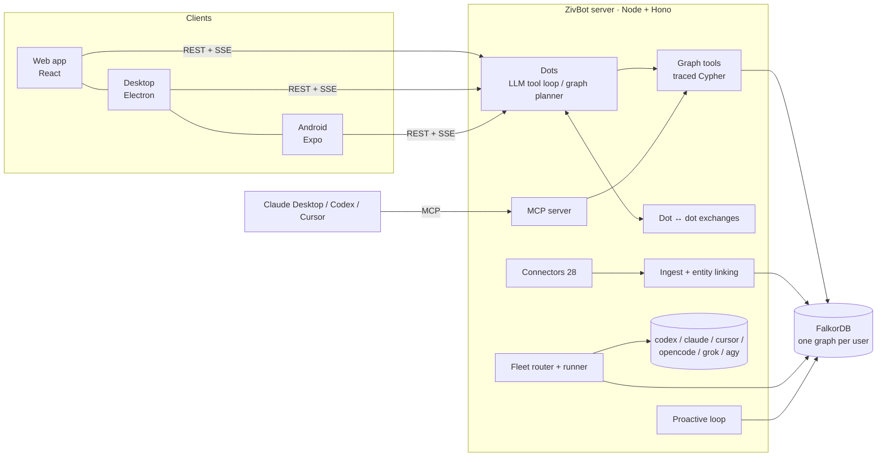

- **One graph per user** (`ziv_<userId>`), using FalkorDB's multigraph tenancy, plus a small `ziv_registry` graph.
- **Traced queries.** Every Cypher statement goes through `UserGraph.q()`. During a turn, an `AsyncLocalStorage` trace collects each query (label, Cypher, params, ms, rows) and every node uid the results touched. That becomes an `(:Answer)-[:USED]->(node)` provenance subgraph.
- **Brain.** Any OpenAI-compatible endpoint with tool calling works (OpenRouter's free models by default). Without a key, the **graph planner** maps intents to the same tools, so the app fully works with no LLM.
- **MCP both ways.** ZivBot *consumes* any MCP server, whose tools become `:Tool` nodes the dot finds with `find_tools`. ZivBot also *is* an MCP server (`npm run mcp`), so Codex, Claude Code and Cursor can query your graph.

## Graph data model

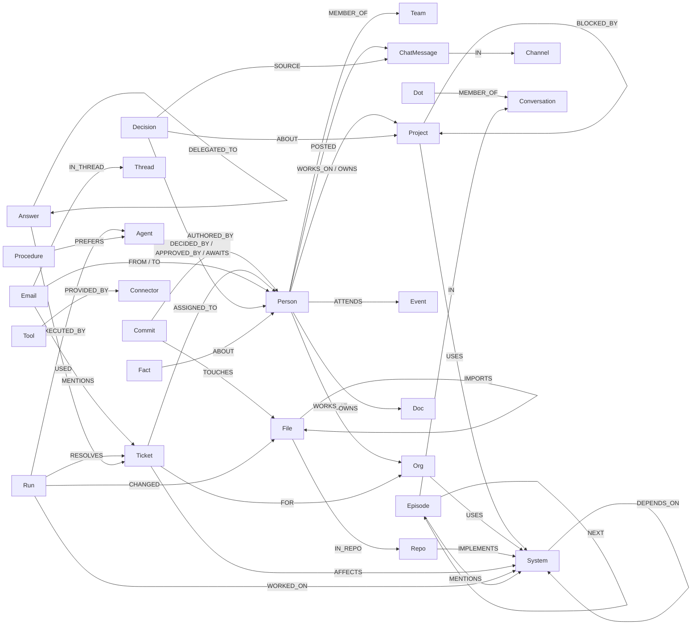

| Layer | Labels |
|---|---|
| Connected data | `Person` `Team` `Org` `Project` `System` `Repo` `File` `Commit` `Ticket` `Email` `Thread` `Event` `Doc` `ChatMessage` `Channel` `Decision` |
| Agent fleet | `Agent` (a subscription/CLI) · `Run` · `Tool` · `Connector` |
| Memory | `Dot` · `Conversation` (direct / group / exchange) · `Episode` (episodic) · `Fact` (semantic) · `Procedure` (procedural) · `Answer` (provenance) · `Draft` (approvals) · `Notice` |

- **Identity across apps.** Every node has a `uid`. Every entity also carries `:Searchable` with a `search` field, so **one full-text index** covers all labels. People are matched across Gmail, Slack, Linear, GitHub and git by email, then by name (`upsertPeople`).
- **Entity linking.** Free text (mail, chat, docs, commits, even chat with the dots) is scanned against a dictionary built *from the graph* (names, aliases, ticket keys) to add `MENTIONS` edges. Anything one connector ingests becomes linkable by every other connector.
- **Derived structure** is recomputed after each sync (`server/analytics.ts`):
  - `(:Person)-[:COLLABORATES {weight}]->(:Person)` from shared mail, meetings, projects, channels and files.
  - `Person.rank` from `algo.pageRank`.
  - `Person.community` from `algo.labelPropagation`.
  - `Person.broker` from `algo.betweenness`.
  - `System.criticality` from PageRank over `DEPENDS_ON`.

## The Cypher the product depends on

All of these are in `server/tools.ts`, `server/fleet.ts` and `server/analytics.ts`, and you can watch them run live in the trace drawer.

**Blast radius** — what breaks if a system goes down:
```cypher
MATCH p = (d:System)-[:DEPENDS_ON*1..4]->(s:System {uid:$u})
RETURN d.uid AS uid, d.name AS name, min(length(p)) AS hops ORDER BY hops
```
```cypher
UNWIND $all AS u MATCH (o:Org {kind:'customer'})-[:USES]->(:System {uid:u})
WITH DISTINCT o RETURN sum(o.arr) AS arr
```

**Triage** — open incidents with dependents and customers at risk:
```cypher
MATCH (t:Ticket {status:'open'})-[:AFFECTS]->(s:System) WHERE t.priority IN ['P1','P2']
OPTIONAL MATCH (t)-[:FOR]->(o:Org)
OPTIONAL MATCH (t)-[:ASSIGNED_TO]->(a:Person)
OPTIONAL MATCH (dep:System)-[:DEPENDS_ON*1..3]->(s)
OPTIONAL MATCH (cust:Org {kind:'customer'})-[:USES]->(used:System) WHERE used = s OR used = dep
RETURN t.key, t.title, t.priority, collect(DISTINCT s.name) AS systems, a.name AS assignee,
       count(DISTINCT dep) AS dependents, collect(DISTINCT cust.name) AS customers, sum(DISTINCT coalesce(cust.arr,0)) AS arrAtRisk
```

**Who knows X** — six signals, weighted and merged. Commits:
```cypher
MATCH (x {uid:$u}) MATCH (p:Person)<-[:AUTHORED_BY]-(c:Commit)-[:TOUCHES]->(f:File)
WHERE f = x OR (f)-[:IN_REPO]->(x) OR (f)-[:IN_REPO]->(:Repo)-[:IMPLEMENTS]->(x)
RETURN p.uid, p.name, count(DISTINCT c) AS n
```

**Agent routing** — pick the subscription for a job:
```cypher
MATCH (a:Agent)
OPTIONAL MATCH (a)<-[:EXECUTED_BY]-(r:Run)-[:WORKED_ON]->(s:System) WHERE s.uid IN $systems
WITH a, collect(r) AS here
OPTIONAL MATCH (a)<-[:EXECUTED_BY]-(r2:Run)-[:WORKED_ON]->(:System)-[:DEPENDS_ON]-(n:System) WHERE n.uid IN $systems
WITH a, here, collect(DISTINCT r2) AS near
OPTIONAL MATCH (a)<-[:EXECUTED_BY]-(r3:Run) WHERE r3.status IN ['succeeded','failed']
WITH a, here, near, collect(r3) AS all
OPTIONAL MATCH (p:Procedure)-[pref:PREFERS]->(a)
RETURN a.name, a.installed, coalesce(a.limitedUntil,0) AS limitedUntil,
       size([x IN here WHERE x.status='succeeded']) AS wins, size([x IN here WHERE x.status='failed']) AS losses,
       size([x IN near WHERE x.status='succeeded']) AS nearWins, sum(CASE WHEN pref IS NULL THEN 0 ELSE pref.weight END) AS preference
```

**Decision trail** — trace a decision back to its source:
```cypher
MATCH (d:Decision) WHERE d.uid IN $ids OR (d)-[:ABOUT]->({uid:$x})
OPTIONAL MATCH (d)-[:DECIDED_BY]->(by:Person) OPTIONAL MATCH (d)-[:APPROVED_BY]->(ap:Person)
OPTIONAL MATCH (d)-[:SOURCE]->(src)
RETURN d.text, d.status, by.name, ap.name, collect(DISTINCT {name: src.name, source: src.source}) AS sources
```

**How are A and B connected:**
```cypher
MATCH p = (a {uid:$a})-[*1..4]-(b {uid:$b})
WHERE none(r IN relationships(p) WHERE type(r) IN ['COLLABORATES','IN_THREAD','BY'])
  AND none(n IN nodes(p) WHERE n:Episode OR n:Answer)
RETURN [n IN nodes(p) | n.name], [r IN relationships(p) | type(r)], length(p) AS hops ORDER BY hops LIMIT 3
```

**Graph algorithms:**
```cypher
CALL algo.pageRank('Person', 'COLLABORATES') YIELD node, score SET node.rank = score
CALL algo.labelPropagation({nodeLabels:['Person'], relationshipTypes:['COLLABORATES']}) YIELD node, communityId SET node.community = communityId
CALL algo.betweenness({nodeLabels:['Person'], relationshipTypes:['COLLABORATES']}) YIELD node, score SET node.broker = score
CALL algo.pageRank('System', 'DEPENDS_ON') YIELD node, score SET node.criticality = score
```

**Semantic memory: vector search, then graph expansion:**
```cypher
CREATE VECTOR INDEX FOR (n:Memorable) ON (n.emb) OPTIONS {dimension: 384, similarityFunction: 'cosine'}
CALL db.idx.vector.queryNodes('Memorable', 'emb', $k, vecf32($v)) YIELD node, score
UNWIND $uids AS u MATCH (n {uid: u})-[r]-(m) WHERE m:Person OR m:System OR m:Org OR m:Ticket OR m:Decision
RETURN u, type(r), m.name
```

**What if someone is out — who else knows each system they know:**
```cypher
MATCH (s:System)
OPTIONAL MATCH (a:Person)<-[:AUTHORED_BY]-(:Commit)-[:TOUCHES]->(:File)-[:IN_REPO]->(:Repo)-[:IMPLEMENTS]->(s)
WITH s, collect(DISTINCT a.uid) AS k1
OPTIONAL MATCH (s)<-[:ABOUT]-(:Doc)<-[:OWNS]-(b:Person)
WITH s, k1, collect(DISTINCT b.uid) AS k2
OPTIONAL MATCH (s)<-[:AFFECTS]-(:Ticket)-[:ASSIGNED_TO]->(c:Person)
WITH s, k1, k2, collect(DISTINCT c.uid) AS k3
WITH s, k1 + k2 + k3 AS k WHERE $p IN k
RETURN s.name, s.tier, k   // remove $p from k: empty = orphaned, one left = fragile
```

**What's blocking a launch — upstream projects, then incidents on what they ship on:**
```cypher
MATCH path = (r:Project {uid:$u})-[:BLOCKED_BY*1..4]->(x:Project)
RETURN x.name, length(path) AS depth, [n IN nodes(path) | n.name] AS via
```
```cypher
MATCH (x:Project)-[:USES]->(s:System) WHERE x.uid IN $chain
MATCH dp = (s)-[:DEPENDS_ON*0..3]->(d:System)<-[:AFFECTS]-(t:Ticket {status:'open'})
WHERE t.priority IN ['P1','P2']
RETURN t.key, x.name, [n IN nodes(dp) | n.name] AS route
```

**Customer health — incidents a customer feels without filing them:**
```cypher
MATCH (:Org {uid:$o})-[:USES]->(s:System)-[:DEPENDS_ON*0..3]->(d:System)<-[:AFFECTS]-(t:Ticket {status:'open'})
WHERE t.priority IN ['P1','P2'] AND NOT (t)-[:FOR]->(:Org {uid:$o})
RETURN t.key, t.priority, collect(DISTINCT s.name)[0] AS via
```

**Single points of failure** (ranked with dependency PageRank, set in `analytics.ts`):
```cypher
CALL algo.pageRank('System', 'DEPENDS_ON') YIELD node, score SET node.criticality = score
```
```cypher
MATCH (s:System) OPTIONAL MATCH (d:System)-[:DEPENDS_ON*1..5]->(s)
WITH s, collect(DISTINCT d) AS deps UNWIND [s] + deps AS x
OPTIONAL MATCH (o:Org {kind:'customer'})-[:USES]->(x)
RETURN s.name, size(deps) AS dependents, collect(DISTINCT o.name) AS customers
```

**Knowledge risk (bus factor):**
```cypher
MATCH (s:System) WHERE s.tier IN ['critical','high']
OPTIONAL MATCH (a:Person)<-[:AUTHORED_BY]-(:Commit)-[:TOUCHES]->(:File)-[:IN_REPO]->(:Repo)-[:IMPLEMENTS]->(s)
WITH s, collect(a.uid) AS commits
OPTIONAL MATCH (s)<-[:ABOUT]-(:Doc)<-[:OWNS]-(b:Person)
WITH s, commits, collect(b.uid) AS docs
OPTIONAL MATCH (s)<-[:AFFECTS]-(:Ticket)-[:ASSIGNED_TO]->(c:Person)
RETURN s.name, commits, docs, collect(c.uid) AS tickets
```

**Decision stakes:**
```cypher
MATCH (d:Decision {uid:$u})-[:ABOUT]->(x)
OPTIONAL MATCH (x)<-[:BLOCKED_BY]-(blocked:Project)
OPTIONAL MATCH (x)-[:USES|AFFECTS|PART_OF*1..2]-(s:System)
OPTIONAL MATCH (s)<-[:DEPENDS_ON*0..3]-(:System)<-[:USES]-(o:Org {kind:'customer'})
RETURN collect(DISTINCT blocked.name), collect(DISTINCT s.name), collect(DISTINCT o.name)
```

**Algorithms as tools** (from `server/algorithms.ts`):
```cypher
CALL algo.pageRank('System', 'DEPENDS_ON') YIELD node, score
CALL algo.HarmonicCentrality({nodeLabels:['Person'], relationshipTypes:['COLLABORATES']}) YIELD node, score
CALL algo.WCC({nodeLabels:['System'], relationshipTypes:['DEPENDS_ON']}) YIELD node, componentId
MATCH (s {uid:$src}) CALL algo.BFS(s, 3, 'DEPENDS_ON') YIELD nodes
MATCH (s {uid:$src}), (t {uid:$dst})
CALL algo.SPpaths({sourceNode: s, targetNode: t, relTypes: ['COLLABORATES'], weightProp: 'cost', maxLen: 6, pathCount: 3}) YIELD path, pathWeight
```

**Rebalance: knowledge minus load:**
```cypher
MATCH (t:Ticket {uid:$u})-[:AFFECTS]->(s:System) MATCH (p:Person)
OPTIONAL MATCH (p)<-[:AUTHORED_BY]-(c:Commit)-[:TOUCHES]->(:File)-[:IN_REPO]->(:Repo)-[:IMPLEMENTS]->(s)
…
OPTIONAL MATCH (p)<-[:ASSIGNED_TO]-(open:Ticket {status:'open'})
OPTIONAL MATCH (p)-[:ATTENDS]->(e:Event) WHERE e.start > $now AND e.start < $soon
RETURN p.name, commits, docs, tickets, count(DISTINCT open) AS load, count(DISTINCT e) AS meetings
```

**Watch rule: an open P1 that reaches a customer:**
```cypher
MATCH (t:Ticket {status: 'open', priority: 'P1'})-[:AFFECTS]->(s:System)
MATCH (s)<-[:DEPENDS_ON*0..3]-(:System)<-[:USES]-(o:Org {kind: 'customer'})
WITH t, collect(DISTINCT o.name) AS customers, sum(DISTINCT o.arr) AS arr
RETURN t.uid, t.key, customers, arr
// then: MERGE (r:Rule {uid:$rule})-[f:FIRED_ON]->(t) so it never fires twice
```

**Working groups — label propagation over strong ties only:**
```cypher
MATCH (a:Person)-[c:COLLABORATES]->(b:Person) WHERE c.weight >= 2 MERGE (a)-[:CLOSE_TO {weight: c.weight}]->(b)
```
```cypher
CALL algo.labelPropagation({nodeLabels: ['Person'], relationshipTypes: ['CLOSE_TO']}) YIELD node, communityId
SET node.community = communityId
```

**Same person in two apps (shared 2-hop working context):**
```cypher
UNWIND $pairs AS p
MATCH (a:Person {uid: p.a})-[*1..2]-(x) WHERE x:System OR x:Ticket OR x:Project OR x:File OR x:Channel OR x:Thread
WITH p, collect(DISTINCT x.uid) AS A
MATCH (b:Person {uid: p.b})-[*1..2]-(y) WHERE y:System OR y:Ticket OR y:Project OR y:File OR y:Channel OR y:Thread
WITH p, A, collect(DISTINCT y.uid) AS B
RETURN p.a, p.b, [u IN A WHERE u IN B] AS shared, size(A), size(B)
```

**Agent skill graph:**
```cypher
MATCH (a:Agent)<-[:EXECUTED_BY]-(r:Run)-[:WORKED_ON]->(sys:System) WHERE r.status IN ['succeeded','failed']
WITH a, sys, count(CASE WHEN r.status = 'succeeded' THEN 1 END) AS wins, count(CASE WHEN r.status = 'failed' THEN 1 END) AS losses
MERGE (a)-[s:SKILLED_IN]->(sys) SET s.wins = wins, s.losses = losses, s.score = (wins + 1.0) / (wins + losses + 2.0)
```

**Full-text search across every label:**
```cypher
CALL db.idx.fulltext.queryNodes('Searchable', $q) YIELD node, score
```

**Memory** — what applies to this turn, from any dot:
```cypher
MATCH (e:Episode)-[:MENTIONS]->(x) WHERE x.uid IN $about AND NOT (e)-[:IN]->(:Conversation {uid:$conv})
OPTIONAL MATCH (e)-[:BY]->(d:Dot) RETURN e.role, e.text, d.name ORDER BY e.at DESC LIMIT 5
```

**Provenance:**
```cypher
MATCH (a:Answer {uid:$a}) UNWIND $touched AS x MATCH (n {uid:x}) MERGE (a)-[:USED]->(n)
```

## Run it

**Requirements:** Node 20+ and Docker. Coding-agent CLIs are optional; ZivBot detects whichever you have.

```bash
docker run -d --name zivbot-falkordb -p 6379:6379 -p 3000:3000 falkordb/falkordb:latest
```
```bash
npm install
```
```bash
cp .env.example .env
```
```bash
npm run dev
```

Then open **http://localhost:5173**. The API runs on 8787, and the FalkorDB Browser on http://localhost:3000. Everything in one go with Docker:

```bash
docker compose up -d --build
```

### Hosted deploy (what runs at zivbot.vercel.app)

| Piece | Where | How |
|---|---|---|
| Web app | Vercel | `vercel.json` builds `npm run build` → `dist`, with `VITE_API_BASE` set to the API URL |
| API | Railway | this `Dockerfile`, a volume on `/data`, health check `/api/health` |
| FalkorDB | Railway | FalkorDB's own template, reached over Railway's private network (`FALKORDB_URL=${{FalkorDB.FALKORDB_PRIVATE_URL}}`) |

The API runs with `ZIV_HOSTED=1`. That refuses connectors that read local paths or spawn processes (MCP, local git, docs folder), and it hands coding-agent runs back to the desktop app, since those use your own subscriptions on your own machine. CORS allows the Vercel origin and anything listed in `ZIV_CORS_ORIGINS`. Every visitor gets their own `ziv_<id>` graph, and the demo workspace is synthetic.

Configuration (`.env`):

| Var | What |
|---|---|
| `FALKORDB_URL` | `redis://localhost:6379` (FalkorDB Cloud works too, with `FALKORDB_USERNAME`/`PASSWORD`) |
| `ZIV_LLM_BASE_URL` / `ZIV_LLM_API_KEY` / `ZIV_LLM_MODEL` | any OpenAI-compatible endpoint with tool calling; `OPENROUTER_API_KEY` alone also works (free model by default). `ZIV_LLM=off` forces the graph planner |
| `ZIV_HOSTED`, `ZIV_CORS_ORIGINS` | public-deploy mode (see above) and extra allowed web origins |
| `ZIV_CODEX_MODEL`, `ZIV_OPENCODE_MODEL` | model pins for dispatched coding agents |
| `ZIV_PROACTIVE_MS` | how often dots scan the graph on their own (0 = off) |

**Demo script** (about 3 minutes):

1. Type your name and pick "Ziv".
2. Click **Connect** on the Lumen Labs workspace.
3. Choose **Suggest a first task**.
4. Click **Show path** on the answer.
5. Ask "Fix LUM-142 and LUM-139", then approve **Codex**. Watch the live run in Forge's chat, where the tests go from 1/3 to 3/3 passing.
6. Ask "Draft a reply to Kate Morgan". The draft now says the fix is ready, because the run is in the graph.
7. Ask "why did we move to Stripe Billing?", "what breaks if billing-db goes down?", and "how is Kate Morgan connected to Priya Raman?".
8. Open the **Graph** tab and the Cypher console.

`scripts/e2e.mjs` drives the whole flow against a running server:

```bash
node scripts/e2e.mjs
```

### MCP

```bash
ZIV_USER=<your id> npm run mcp
```

Add it to any MCP client. For example, Claude Code: `claude mcp add zivbot -- npx tsx /path/to/zivbot/server/mcp.ts`.

The same 30 tools are also served over **Streamable HTTP**, including on the live demo. Copy your command from **Connect apps → Use your graph from any agent**:

```bash
claude mcp add --transport http zivbot "https://zivbot-api-production.up.railway.app/mcp?user=<your id>"
```

You get `triage`, `critical_path`, `diagnose`, `blast_radius`, `what_if_absent`, `customer_health`, `who_knows`, `run_algorithm`, `semantic_search`, `run_cypher` and more. The agent picks the tool, and each answer ends with the Cypher behind it.

### Desktop

`desktop/` is an Electron shell, so the dots really do run on their own computer. It:

- starts FalkorDB through Docker if needed
- runs the bundled server
- opens the app with a macOS inset title bar and a tray icon
- lets you pair your phone over the LAN

```bash
cd desktop && npm install && npm run bundle && npm start
```

### Android

`mobile/` is an Expo (SDK 52) app. <p>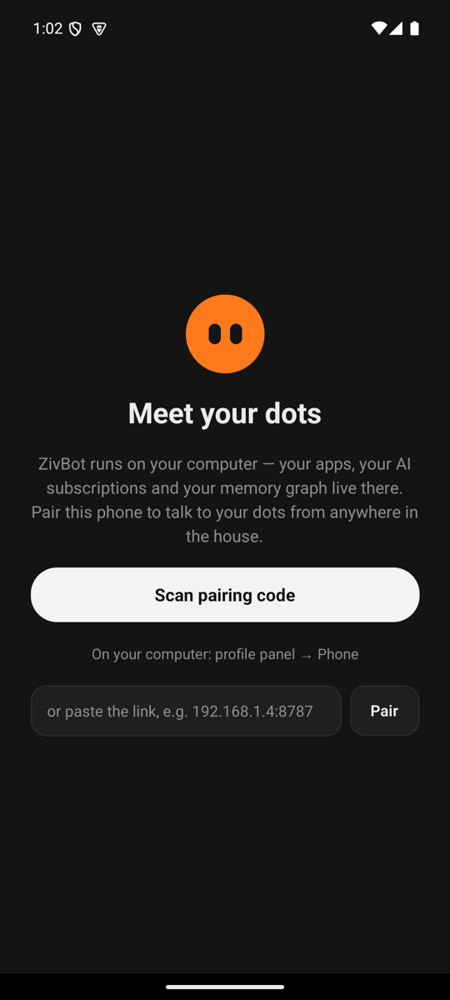 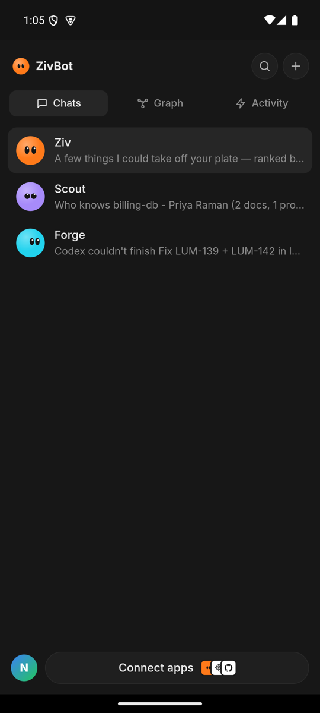</p>

Pair it by scanning the QR code under *profile panel → Phone* on your computer. From then on your phone talks to the dots on your computer: the same graph, with native notifications and haptics. The coding agents and your data stay on your machine.

```bash
cd mobile && npm install && npx expo start --android
```

For an APK: `eas build -p android --profile preview`.

## Data used

The demo graph uses only **synthetic data** (the fictional Lumen Labs, under `server/seed/lumen.ts` and `demo/lumen-payments`) and **public data** (public GitHub repos, HN, RSS, Wikipedia), per hackathon rule 6. The key-based connectors are built for real use after the hackathon. Credentials are stored in `~/.zivbot/secrets.json` (mode 0600) and never in the graph.

## Project layout

```
server/            Hono API, agent, tools, fleet, memory, connectors, MCP server
  tools.ts         graph tools (all the Cypher above)
  agent.ts         dot turns: LLM tool loop / graph planner, dot↔dot messaging, onboarding
  fleet.ts         coding-agent subscriptions: detect, route (Cypher), run, record
  memory.ts        conversations, episodes, provenance
  analytics.ts     COLLABORATES + PageRank / label propagation / betweenness
  connectors/      demo workspace, public (no key), live (API key), MCP client
web/               React UI (GrokBot / ChatGPT-dots style)
desktop/           Electron app
mobile/            Expo Android/iOS app
demo/              lumen-payments: the synthetic repo the coding agents fix
```

## How the demo video was made

There are no mocks in it. `desktop/scripts/record.cjs` drives the real app in an offscreen Electron window against the local API and FalkorDB, capturing 10 frames a second. In that recording it:

- connects the demo company and FalkorDB's public GitHub repo;
- asks the questions;
- approves a real Codex run on `demo/lumen-payments`, where the tests go from 1/3 to 3/3;
- runs a real `codex exec` session that calls ZivBot's MCP `critical_path` tool.

The voiceover is [Chatterbox TTS](https://github.com/resemble-ai/chatterbox) running locally (`docs/video/tts.py`, from the lines in `docs/video/script.json`). `scripts/make-video.py` fits each scene to its line and burns in the captions.

## Built with AI assistance (rule 11)

ZivBot was built during the hackathon with **Claude Code** (Anthropic) as a coding assistant, plus a background sub-agent that wrote the API-key connector adapters. The logo, character art and hero image were generated with ChatGPT image generation and cut out locally (originals in `brand/`). The product direction, the graph model decisions, testing against real coding agents and the review are the team's. The coding-agent runner and quota detection are adapted from the author's own open-source project [Loom](https://github.com/nickthelegend/loom).

## License

MIT
